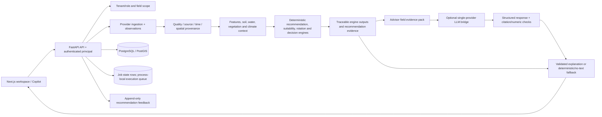
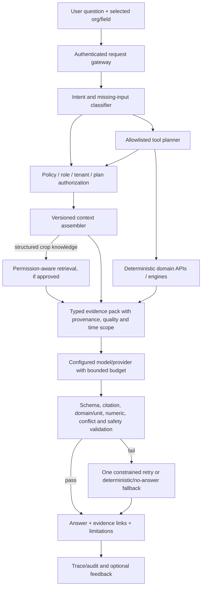

# CropTwist AI Architecture — Current State and Target

**Updated:** 2026-11-14
**Repository audit baseline:** `main` at `01f9fa2524a71a1bee40e523b729e4c73f6d37d9` plus explicitly identified working-tree changes.
**Design principle:** CropTwist is an evidence-driven agricultural decision-support system. Engines calculate; validated evidence bounds conclusions; AI orchestrates and explains; farmers decide.

## Executive summary

The repository has a useful separation between deterministic agronomic/decision engines and optional LLM-generated prose. Farm/field authorization and data services produce context; recommendation generators, water/soil/rotation/scenario engines create traceable outputs; advisor and recommendation modules can ask a language model to explain those facts; a rules fallback exists when the bridge is unavailable.

It is not an autonomous agronomist. The current LLM integration is a single-provider bridge, not a model-independent orchestration platform; the current structured crop knowledge is not document RAG; no model-selected tool-execution layer was found; and no trained/deployed predictive ML model or training lifecycle was found. AI safety is uneven: advisor Q&A has citation and numeric checks; field briefs now have structured citation/numeric validation and one retry followed by no model text; recommendation narratives still bypass the same runtime contract. Existing numeric validation is not a guarantee of unit/domain grounding.

## Current data and decision flow

### Existing components

- **Domain evidence:** observation/provider contracts, source/product labels, quality flags, field state snapshots, feature lineage, knowledge pack citations, engine outputs, recommendation evidence, scenario/sensitivity/robust/decision artifacts, and `/verify` contracts.
- **Deterministic engines:** crop suitability screens, rotation optimization, water planning, soil and nutrient accounting, management/residue/cover practices, satellite/vegetation analysis, recommendation rules, scenarios, sensitivity and robust decisions. These remain the numerical authority; reference knowledge and partial inputs retain their caveats.
- **LLM bridge:** FastAPI can call an external bridge; the bridge integrates one provider SDK and may be absent/unconfigured. The backend can operate without it. Timeout/token/cost/provider fallback controls are incomplete.
- **Advisor:** persisted question/answer sessions assemble a field evidence pack and recent conversation, accept structured answer/citation information, validate citations against that pack, check numerical claims, optionally regenerate once, and fall back to deterministic text when required.
- **Field briefs:** the current working change requires structured JSON, at least one inline `[evidence: LABEL]` citation that resolves to the current pack, and numeric screening. One constrained retry is allowed; repeated invalid output becomes `summary: null` with rules mode.
- **Recommendation narratives:** generated text can be attached to rule-generated recommendation rows, but the code does not yet apply the same citation/numeric fail-closed contract. Until corrected, narrative prose is not a verified agronomic fact; the deterministic recommendation and its evidence remain authoritative.
- **Feedback:** feedback records user responses against recommendations. It is not an automatic rule update or model-retraining pipeline.
- **Retrieval/model/tool layer:** no document ingestion/chunking/embedding/vector index or evidence-aware external-source RAG; no provider-agnostic model registry/fallback router; no model-selected tool executor; no persistent token/spend accounting found in scope.
- **Predictive ML:** no trained/deployed yield, water-demand, crop-stress, crop-performance, or climate-risk model with labeled data, evaluation, uncertainty, versioning, drift monitoring, and release controls found. Deterministic scores and statistical screening are not trained prediction.

## Trust boundaries and failure modes

### Authentication and tenant scope

The HTTP/API layer must resolve the caller's principal and active organization/field membership before constructing context or allowing a tool. Session identity and selected organization are separate concepts: the frontend must explicitly pass the user-selected organization rather than choose the first membership. Never let retrieval, a citation label, a model-generated tool request, or a cached narrative cross tenant boundaries. Advisor history and caches must be keyed by tenant, field, locale, evidence version, and all material generation inputs.

### Evidence provenance and measurement semantics

The evidence pack should preserve, not flatten, important distinctions:

- measured farmer/field data versus provider observations, reanalysis, remotely sensed products, estimates, reference knowledge, synthetic fixtures, and model outputs;
- source, variable, acquisition/observation period, spatial resolution/CRS, quality state, transformation/version, and citation label;
- evidence absent, insufficient, stale, temporally mismatched, or conflicting;
- deterministic rule trigger, heuristic evidence quality, and statistical/model uncertainty.

A generated explanation must not turn a missing dimension into “normal,” interpret reference thresholds as local validation, assert a suitability screen as a yield forecast, or present a scenario result as measured data.

### Numeric and citation validation

A safe numeric check must bind each claim to a specific pack fact **and compatible units/meaning**, not merely to a value that appears anywhere in a global evidence collection. It should distinguish direct values from allowed transformations and contain conversion formulas with tests. A valid citation must exist in the current pack and refer to evidence compatible with that claim. If the model provides an unknown citation, unsupported magnitude/unit, incompatible time window, conflicting-source conclusion, malformed response, or unhandled output type, reject the prose and return deterministic/no-model output.

The current `numeric_guard` is screening-grade. It is global-value oriented and contains an incorrect `kg/ha`/`Mg/ha` factor. Do not represent it as complete. The current field-brief gate improves visible citation and number checks, but the narrative path and prompt trust boundaries remain open.

### Prompt and tool trust

The model sees untrusted farmer questions and farm/field metadata. Delimiter wrapping without escaping is not a sufficient prompt boundary. Treat every user/database string as data, use explicit serialized content boundaries, and do not include credentials, hidden system data, another tenant's context, or unrequested PII.

No model-selected function/tool call currently executes as a first-class capability. When tools are introduced, the model may propose an intent; the server must independently authorize the actor, validate typed arguments, apply quotas/timeouts/idempotency, invoke only an allowlisted deterministic service, record the inputs/outputs and trace ID, and return the result to the evidence pack for validation. The model must never construct raw SQL, shell commands, arbitrary URLs, direct filesystem paths, or unscoped tenant queries.

## Target architecture

### Required request and response contracts

**Request context** should identify authenticated actor, active organization, optional farm/field, locale, time window, intent, and requested operation. Authorization is completed before data retrieval/tool selection. Missing organization/field/season information prompts a clarification instead of guessing. The system may return deterministic results without an LLM.

**Evidence-pack item** should carry a stable ID and label; tenant/field scope; source class and reference; variable/value/unit; quality; temporal/spatial scope; transformation/method version; and whether it is observed, estimated, reference, synthetic, or missing. Model context should contain only the authorized subset needed for the request.

**Model response** should be typed: answer segments/claims; citations linked to allowed evidence IDs; numeric values/units when applicable; deterministic tool-result references; uncertainty/limitations; suggested follow-up if inputs are missing; and model/provider/version metadata. Validate the full response before rendering or persistence. Do not accept arbitrary prose fallback if parsing/validation fails.

### Specialized agricultural intelligence

Keep core agricultural calculations in deterministic and separately evaluated engines. Every capability needs explicit input/output schemas, evidence requirements, method version, supported ranges/geography/time windows, status (assessed/partial/insufficient/unavailable), and tests. Candidate interfaces include:

- vegetation indices/stress and soil/water/climate evidence;
- crop suitability and rotation alternatives under hard/soft constraints;
- seasonal water plans and missing water inputs;
- management/nutrient/soil context;
- scenario and sensitivity comparisons;
- anomaly/risk screens with temporal alignment.

The LLM can route/sequence allowed APIs and explain their results; it must not replace an engine's numerical result. Correct regional knowledge resolution, season-specific objective alignment, and incomplete-evidence status before presenting cross-season conclusions as complete.

### Knowledge retrieval (optional future RAG)

RAG is a separate product capability, not a label for the existing knowledge tables. Before implementation, define corpus ownership/licensing, source and revision metadata, geography/crop applicability, review status, parsing quality, permission filters, temporal validity, update/removal policy, retrieval evaluation, citation format, and stale/conflicting document behavior. Evaluate hybrid/vector retrieval on questions with known expected sources. A retrieved source is not proof that its claim applies to the field; the deterministic evidence and applicability contract still governs the answer.

### Provider independence and model selection

A provider/model adapter should advertise capabilities (structured output, tool calling, context length, vision if required), support bounded deadline/retries and rate limits, report sanitized errors/health, track token usage and cost from a maintained price schedule, and allow a configured primary plus approved fallback. Fallback may not change claims, silently switch tenant, or become unbounded. Store provider/model/prompt version and safety outcomes for traceability. Validate model terms, pricing, availability and credentials in the target environment before enabling; never store secret values in reports or logs.

### Predictive models

A predictive service is a distinct layer from deterministic engine rules and LLM prose. For every model state the target, input features, label source, geography/season, training cutoff, train/validation/test split, leakage controls, baseline, metrics, uncertainty calibration, applicability/OOD behavior, model/data version, monitoring, rollback and external agronomic validation. Do not show predictions when evidence is insufficient or the field is outside the validated domain. A prediction is not a prescription; farmer decisions remain explicit.

## Recommended implementation sequence

1. **Close immediate trust gaps:** consistent exact authorization/entitlements; verified-registration gating; complete Alembic metadata; observation/HLS/job integrity; finish the narrative gate; fact-bound unit-aware numeric checks; prompt input encoding.
2. **Freeze contracts and evaluation:** canonical evidence pack and claim/citation schemas; deterministic mock suites for supported/unsupported numbers, time conflicts, missing data, fake citations, prompt injection, provider errors, and deterministic fallback.
3. **Integrate the frontend:** explicit organization/field selection; citation/evidence links; visible limitations, quality and stale/missing states; bounded retry; browser, accessibility, responsive and Arabic RTL tests.
4. **Harden execution:** idempotent audited tools, bounded queue and provider budgets, shared queue/claims for replicas if needed, durable traces and aggregate spend/latency metrics.
5. **Verify external services:** only after approved credentials/infrastructure are available, test live catalog discovery vs protected assets, object storage, email, payments and LLM provider separately; record the last successful sanitized check.
6. **Approve optional RAG/ML by value case:** source and permission policy first, then benchmarks, uncertainty, model governance and controlled release; no automatic retraining from unreviewed feedback.

## Non-goals and safety commitments

- The LLM is not the source of agronomic facts, geospatial measurements, or model outputs.
- Crop suitability, recommendation priority, statistical anomaly screening, and yield prediction are separate concepts.
- No global/reference crop threshold is called regionally agronomist-validated unless it has been reviewed.
- Synthetic fixtures are not field observations.
- Missing evidence remains missing, not a zero/normal score.
- LLM narrative, document retrieval, or feedback cannot silently change deterministic rules or train/deploy a model.
- External source/service availability, payment delivery, email delivery, and production readiness are claims requiring current environment evidence.
