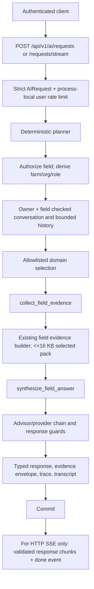

# CropTwist AI Core Architecture

**Status:** Current backend architecture on `feature/ai-complete-integration`, based on the checked-out source. This is an implementation description, not a claim that every test has passed, that a provider is reachable, that migrations have been applied to a target database, or that the system is production-ready. Final integration counts and verification status belong in [`MASTER_INTEGRATION_ENGINEERING_REPORT.md`](../../../../docs/implementation/MASTER_INTEGRATION_ENGINEERING_REPORT.md).

## Purpose and implementation history

The Core centralizes authenticated, field-scoped, read-only explanations over existing stored field evidence. It reuses the existing evidence builder and advisor/validation path; it does not replace domain engines or confer authority on model output. The original orchestration foundation established deterministic planning, tool bounds, common response contracts, owner-stamped Core sessions, and privacy-conscious traces. The current implementation extends that foundation with the two-step evidence workflow, HTTP provider adapters and gated fallback chain, provider-attempt traces, feedback lifecycle, tenant-scoped knowledge-ingestion/retrieval primitives, and retention cleanup.

Migration history in this checkout is additive: `0024_ai_core_orchestration` adds nullable session ownership and execution traces; `0025_ai_feedback_knowledge` adds provider-attempt metadata, feedback, and knowledge document/chunk tables. These are revision files, not proof that a deployment database has applied them. The checkout contains migration files through 0025; later integration migrations are tracked separately and are not asserted here as applied or as the current deployed head.

## Runtime architecture

The planner is deterministic server code. It does not ask the model to select tools, scopes, field IDs, or permissions. A requested `field_id` is a selector only: the authenticated principal must be authorized for it before evidence is read. Organization, farm, and membership role are derived from the authorized field. The current identity layer grants active organization members field-read access; the AI Core does not create per-domain role ACLs.

## Components and ownership

| Layer | Current implementation | Responsibility |
|---|---|---|
| HTTP gateway | `app/api/v1/ai_core.py` | Authenticated request, discovery, conversation, feedback, provider status, and knowledge endpoints; request correlation and rate checks. |
| Contracts | `app/intelligence/orchestration/contracts.py` | Strict request, deterministic plan, evidence, execution, and response schemas. |
| Planner | `.../planning.py` | Rule-based intent classification, required context, clarification, availability, and ordered tool names. |
| Context | `.../context.py` | Field authorization, server-derived tenant/role, owner+field conversation check, and bounded recent history. |
| Registry | `.../tools.py`, `.../capabilities.py` | Server-allowlisted tools, schemas, permissions, side-effect policy, workflow dependencies, timeout and output ceilings, and discovery. |
| Evidence | `.../evidence.py` plus `app/intelligence/evidence.py` | Selected existing stored domain pack, explicit data gaps, source references, quality and time metadata, and normalized response envelope. |
| Providers | `.../provider.py`, `.../provider_adapters.py`, `.../config.py` | Provider-neutral contracts, Gemini/Groq/OpenRouter HTTP adapters, provider priority/fallback and configuration gates. |
| Validation | `.../validation.py`, existing advisor/guard/numeric validators | Untrusted-input handling, response/citation validation and conservative numeric checks. |
| Persistence | `app/db/models_ai.py`, `app/db/models_orchestration.py`; revisions 0024–0025 | Owner-stamped transcript sessions, lifecycle traces, consented feedback, and organization-scoped text chunks/optional vectors. |
| Retention | `.../retention.py`, `app/core/scheduler.py` | Bounded deletion of expired feedback, traces, and conversations in the existing periodic maintenance scheduler. |
| Offline evaluation | `.../evaluation.py`, `tests/evaluation/ai_core_cases.jsonl` | Deterministic plan and outcome/latency/cost helper logic; not live model accuracy or availability evidence. |

## Request lifecycle

1. FastAPI validates `AIRequest`: nonblank question up to 2,000 characters, optional field/conversation UUIDs, locale `en` or `ar`, and up to eight unique allowlisted context domains. Client-supplied actor, organization, farm, provider/model, tool names, trace IDs, permissions, and tenant scope are rejected as extra fields.
2. The planner maps the question to an intent and server-authored plan. Supported field explanations use two steps: `collect_field_evidence`, then `synthesize_field_answer`; the second step consumes the validated first-step result. The planner is rule-based, not an LLM tool call. `answer_field_question` remains a registered compatibility/one-step handler but is not emitted by the current planner.
3. The context resolver authorizes the field, derives farm/organization/role, and checks that a supplied conversation belongs to the same user and field. Missing, expired, legacy-unowned, cross-field, and other-user Core conversations return the same 404. Recent history is bounded, sanitized, and treated as untrusted text.
4. Planner-selected or caller-narrowed context consists of up to seven evidence domains: `climate`, `water`, `soil`, `rotation`, `management`, `vegetation`, and `data_gaps`. The field profile and data-gap labels are retained by evidence selection. Water can add climate context; rotation can add soil/climate/water; a “why” vegetation question can add climate/water/soil/management. Evidence is filtered from the existing builder output and limited to 16,000 UTF-8 bytes; this is not a new calculation.
5. The evidence-collection output is schema-validated and passed only as a validated prior-step result to synthesis. The bounded registry allows at most three ordered steps overall; the present planner workflow uses two. Tool input/output schemas, permissions, side-effect classification, execution deadline and byte budget are checked independently of model output.
6. For supported narratives, the existing advisor invokes the configured provider chain and applies its response checks; AI Core additionally requires inline evidence labels on factual sentences and checks cited numeric claims against the cited section. On failed strict validation, unvalidated model prose is discarded for a localized, deterministic notice. The model does not select tools or resources.
7. The typed response separates verified facts and stored derived results from predictions, recommendations, general knowledge, assumptions, evidence, limitations, gaps, and follow-ups. Prediction, recommendation, and general-knowledge arrays remain empty for this implementation. No unsupported capability is inferred from model prose.
8. The transcript stores the user/assistant message pair and safe engine/trace metadata. A separate execution trace stores IDs, provider attempts when available, selected domains, evidence fingerprint/references, tool outcomes, validation codes, usage if reported, latency, and normalized status/error—not raw question/answer/evidence values or API credentials.
9. `POST /requests/stream` calls the same complete lifecycle and commits before returning the `StreamingResponse`. It then sends `meta`, answer `chunk` events of up to 160 characters, and a `done` event containing the typed response. This is chunked delivery of a validated, already-generated answer—not first-token live LLM streaming. Provider SSE, where used internally, is collected into a complete answer before validation.

## Provider adapters and privacy policy

The default application-level priority is **Gemini (`gemini-3.6-flash`) → Groq (`openai/gpt-oss-120b`) → OpenRouter (`nvidia/nemotron-3.5-super-vl:free`)**. Provider order, exact model IDs, API keys, and privacy gates are `CROPTWIST_` environment settings only; they are not request parameters or database-managed values. The keys are optional `SecretStr` settings and never appear in the API response. The chain itself is distinct from OpenRouter's internal endpoint routing.

| Provider | Default model | Adapter request contract | Structured/stream notes |
|---|---|---|---|
| Gemini | `gemini-3.6-flash` | `POST https://generativelanguage.googleapis.com/v1beta/models/{model}:generateContent`; `x-goog-api-key` header. | JSON schema uses `generationConfig.responseMimeType="application/json"` and `responseSchema`; schema support is a subset. Provider SSE uses `:streamGenerateContent?alt=sse` and Gemini response frames. |
| Groq | `openai/gpt-oss-120b` | `POST https://api.groq.com/openai/v1/chat/completions`; bearer token; OpenAI-style messages. | Adapter requests strict `response_format.json_schema`; streamed chat-completion chunks use `choices[].delta`. |
| OpenRouter | `nvidia/nemotron-3.5-super-vl:free` | `POST https://openrouter.ai/api/v1/chat/completions`; bearer token; OpenAI-style messages. | When structured output is requested, adapter sets `provider.require_parameters=true`; actual endpoint/model structured-output support is conditional, not asserted as guaranteed. Streamed chat-completion chunks are parsed separately from any usage frame. |

Environment names are `CROPTWIST_LLM_PROVIDER_ORDER` (default `gemini,groq,openrouter`), `CROPTWIST_GEMINI_MODEL` / `CROPTWIST_GEMINI_API_KEY`, `CROPTWIST_GROQ_MODEL` / `CROPTWIST_GROQ_API_KEY`, and `CROPTWIST_OPENROUTER_MODEL` / `CROPTWIST_OPENROUTER_API_KEY`. Field-sensitive content is not sent to remote providers by default: `CROPTWIST_AI_ALLOW_FIELD_DATA_TO_PROVIDERS=false`; OpenRouter additionally requires `CROPTWIST_OPENROUTER_ALLOW_FIELD_DATA=true`. Provider status reports configuration and policy state but does not probe connectivity: `/api/v1/ai/providers` explicitly reports `live_connectivity_verified: false`. The OpenRouter free model page warns that requests may be logged; its separate opt-in is therefore material. A configured key/model is not evidence of successful live inference, approved data processing, or production readiness.

The verified provider references supplied for this work are the [Gemini 3.6 Flash model page](https://ai.google.dev/gemini-api/docs/models/gemini-3.6-flash), [Gemini text generation and streaming](https://ai.google.dev/gemini-api/docs/generate-content/text-generation), [Gemini structured outputs](https://ai.google.dev/gemini-api/docs/structured-output), [Groq Chat Completions](https://console.groq.com/docs/api-reference), [Groq structured outputs](https://console.groq.com/docs/structured-outputs), [OpenRouter model page](https://openrouter.ai/models/nvidia/nemotron-3.5-super-vl:free), [OpenRouter structured outputs](https://openrouter.ai/docs/guides/features/structured-outputs), and [OpenRouter provider routing](https://openrouter.ai/docs/guides/routing/provider-selection). These contracts were recorded in `/home/ubuntu/ai-completion-provider-docs.md`; this document does not assert a fresh live provider check.

## Capability boundary

The available path is a field-bounded explanation of existing stored evidence. Soil, water, climate, vegetation, stress/anomaly, spatial, and saved-rotation information are limited to evidence already present in the field evidence pack. This route does not execute a new soil assessment, water plan, forecast, diagnosis, rotation optimization, field ranking, or simulation.

Crop suitability, risk ranking, scenario simulation, and report integration are **planned**, not callable. Agricultural recommendations/prescriptions, yield or other predictions, agricultural knowledge answering, and platform actions/mutations are **unavailable** in this Core. No approved knowledge corpus or embedding adapter is configured for the advisor. Status descriptors are not executable tools.

## Data, feedback, and retention boundaries

Core conversations are field-bounded and user-owned. New sessions are stamped with the authenticated user ID; pre-existing owner-null sessions are not reused by Core. The recent model context is limited by `advisor_history_turns` (default six turns; at most 12 messages when configured to six). Conversation API history is separately capped at 80 messages per response. Default inactivity expiry is 365 days; `CROPTWIST_AI_CONVERSATION_RETENTION_DAYS=0` disables that expiry/deletion rule. The existing scheduler invokes `ai.retention` every 900 seconds and uses bounded batches (default 1,000 rows per table); configured defaults are 365 days for feedback and 90 days for traces. Retention deletes rows; expiry is not merely an access check.

Feedback requires explicit `quality_review_consent: true`; lifecycle is owner-scoped and accepts `accepted`, `rejected`, `modified`, `implemented`, and `outcome_reported`. User-entered outcome labels remain `unverified_user_reported`; feedback is not automatically used for model training. Knowledge ingestion accepts only organization-manager, rights-attested `text/plain` or Markdown content. Vectors are optional JSONB, with an empty-by-default embedding-provider registry and explicit separate document/query sharing gates. These knowledge primitives are not connected to answer synthesis and do not provide citations until a reviewed source and embedding adapter are actually configured.

## Operational constraints and verification boundary

The shared generic auth/AI limiter is keyed by authenticated user, uses a sliding 60-second window and is process-local. Its storage is bounded at 10,000 active subjects and idle entries expire; it is not a distributed quota. Public API-key traffic follows a separate PostgreSQL-backed budget/rate mechanism and should not be conflated with this AI/auth limiter. For multi-replica deployment, confirm the relevant storage and operational policies independently.

This architecture does not assert that tests are complete, that migrations are applied, or that providers are live. Provider reliability tests are being updated by the provider workstream; no final test result is claimed here. Consult the linked integration engineering report for the authoritative verification ledger. The existing field/domain engines, GIS/report work, user-facing final report, branches, and environment are outside this architecture document's scope.
