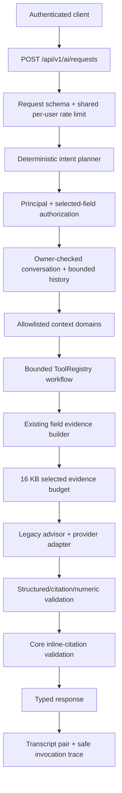

# CropTwist AI Core Architecture

**Status:** backend orchestration foundation on `feature/ai-core-orchestration`. This is not the full Copilot UI, a general-purpose agent, a new agronomic engine, or a production multi-provider deployment.

## Purpose and verified baseline

CropTwist already had a reusable field evidence builder, an evidence-grounded advisor, a Z-AI-backed chat bridge, structured-response/citation validation, numeric checks, anomaly screens, recommendation generators, session persistence, and aggregate AI metrics. The advisor API was field-authorized, but it did not provide a central lifecycle or one common evidence/response envelope. Session ownership was field-only; prompt delimiters were not escaped; numeric matching could compare equal values across incompatible dimensions; the advisor did not retrieve the curated knowledge base. The repository has no operational RAG/vector/embedding retrieval in the reviewed backend.

The implementation reuses `app/intelligence/evidence.py`, `advisor.py`, `bridge.py`, `sessions.py`, `domains/identity/service.py`, `core/rate_limit.py`, and the existing SQLAlchemy `Base`. It adds a thin gateway and orchestration package rather than duplicating auth, persistence, provider transport, or agronomic engines.

## Runtime architecture

The planner is deterministic code; it does not ask the language model to select tools, scopes, permissions, or resource IDs. Identity and context are resolved after classification and before data retrieval. `get_field_for_principal` verifies membership, then the server derives farm, organization, and role from the authorized field. A caller-supplied field ID is only a selector, never authorization. The request model rejects extra actor/tenant properties.

### Module responsibilities

| Layer | Implementation | Responsibility |
|---|---|---|
| Gateway | `app/api/v1/ai_core.py` | Authenticated request, capabilities and tool discovery; shared rate limit; request correlation. |
| Contracts | `app/intelligence/orchestration/contracts.py` | Strict request/plan/evidence/tool/response schemas. |
| Planner | `.../planning.py` | Deterministic intent, missing field, required context, available/planned/unavailable status and ordered steps. |
| Context | `.../context.py` | Field and tenant authorization, role derivation, private session check, bounded transcript and expiry. |
| Registry | `.../tools.py`, `.../capabilities.py` | Server-allowlisted steps, permission/schema checks, timeout/result budgets, side-effect refusal, capability discovery. |
| Evidence | `.../evidence.py` | Allowlisted domain selection, source references, periods, quality flags, missing-data metadata and common envelope. |
| Provider | `.../provider.py` | Provider-neutral interface over the existing bridge; current limits are explicit. |
| Validation | `.../validation.py`, existing advisor/response/numeric guards | Prompt/response parsing, cited-label allowlist, numerical checks and core-specific fail-closed citation policy. |
| Persistence/trace | `models_ai.py`, `models_orchestration.py`, migration `0024_ai_core_orchestration.py` | Private transcript owner, invocation trace and source references without raw prompts/answers in the trace table. |
| Evaluation | `.../evaluation.py`, `tests/evaluation/ai_core_cases.jsonl` | Deterministic plan benchmark, latency percentiles and supplied-price token cost estimate. |

## Request lifecycle

1. FastAPI validates `AIRequest` (`question` 1–2,000 characters; optional field/conversation UUID; `en`/`ar`; up to eight unique allowlisted context domains). The shared limiter uses the authenticated server-side user ID. The existing advisor/insights/LLM-backed recommendation refresh paths use the same bucket.
2. The planner assigns an intent, required context and an ordered server-authored step list. An absent field for a field-bound intent yields clarification; predictions, recommendations, general knowledge, report actions, and platform mutations are not called through this gateway unless a capability is explicitly registered.
3. The resolver authorizes the field, derives its organization and role from the database, and checks that any conversation is for this field and is owned by this user. An expired, missing, legacy-unowned, cross-field, or other-user Core conversation returns the same 404.
4. Only selected, approved evidence domains are passed to the tool. `field` and `data_gaps` are retained; selected evidence is capped at 16,000 UTF-8 bytes before a provider call. Provider-visible question, evidence and history are wrapped as untrusted content; delimiters are HTML-escaped.
5. The bounded tool workflow sequentially validates each step's tool name, permissions, arguments and result schema. It supports at most three steps, exposes validated prior step results to subsequent handlers, and traces each step. Built-in planner rules currently emit one operational tool (`answer_field_question`); multi-tool domain workflows await future registered engines and deterministic plans.
6. The existing advisor performs its structured-response/citation/numeric validation and at most one constrained regeneration. The AI Core then requires inline citations for every factual sentence and rechecks cited numeric claims against the cited evidence section. A failed core validation returns a safe deterministic notice, not unvalidated model prose.
7. The response separates verified facts, derived results, predictions, recommendations, general knowledge, assumptions, evidence, limitations, missing information and follow-ups. No prediction/recommendation/general-knowledge tool is currently registered; those response arrays stay empty.
8. The user/assistant transcript pair is persisted against the owned session. A separate append-only trace records status, latency, safe error category, IDs, tool outcomes, provider/model when known, source references, evidence hash, validation codes and optional token counts—not the raw question, answer, evidence values, secrets, or prompt.

## Current capability boundary

Operational field explanation is available through existing evidence-backed services. Soil, water, climate, vegetation, stress/anomaly and saved-rotation explanations are **partial**: only stored evidence is explained; the route does not rerun a domain engine, diagnose a crop, forecast weather, optimize a rotation, or rank fields. Suitability, scenario simulation, risk ranking, and reporting are **planned**. Agricultural knowledge retrieval, recommendation/prescription, predictive modeling and platform operations are **unavailable**. A planned/unavailable descriptor is not a callable tool.

Only `answer_field_question` is registered today. It is analytical, side-effect-free, field-scoped, requires `field.read` and `field.analysis.read`, has a 50-second timeout and a 64 KB result limit. The adapter uses the existing Z-AI bridge, but it does not advertise native structured output, model tool calling, streaming, or guaranteed usage reporting. Prompted JSON parsing is not native structured-output support.

## Context and storage boundaries

The current gateway is field-scoped. It does not accept an organization-only conversation or scan a farm portfolio. The existing identity layer allows active organization members to read a field; it has no per-domain ACL. Internal `field.read`/`field.analysis.read` permission labels do not represent role-specific domain grants.

New sessions have `owner_user_id`; existing rows remain `NULL` for migration compatibility. Core does not reuse legacy NULL-owner sessions. The legacy advisor APIs still permit field-authorized users to access legacy unowned history, but new owner-stamped sessions are private to their creator. Inactive Core conversations are inaccessible after `CROPTWIST_AI_CONVERSATION_RETENTION_DAYS` (default 365 days, 0 disables); this is an access expiry, not a transcript deletion job.

## Non-goals / next integration seams

No specialized crop, suitability, risk, scenario, prediction, GIS, report or RAG implementation is duplicated here. Their contract/availability descriptors are in `docs/architecture/CROPTWIST_AI_TOOL_REGISTRY.md`. No action tools, frontend Copilot, provider selection/failover policy, distributed limiter, trace-query UI, knowledge-base retrieval, or production deployment change is included. The GIS/report implementation remains an independent workstream; this branch only adds the AI router to the existing API aggregation point and does not edit its GIS/report code.